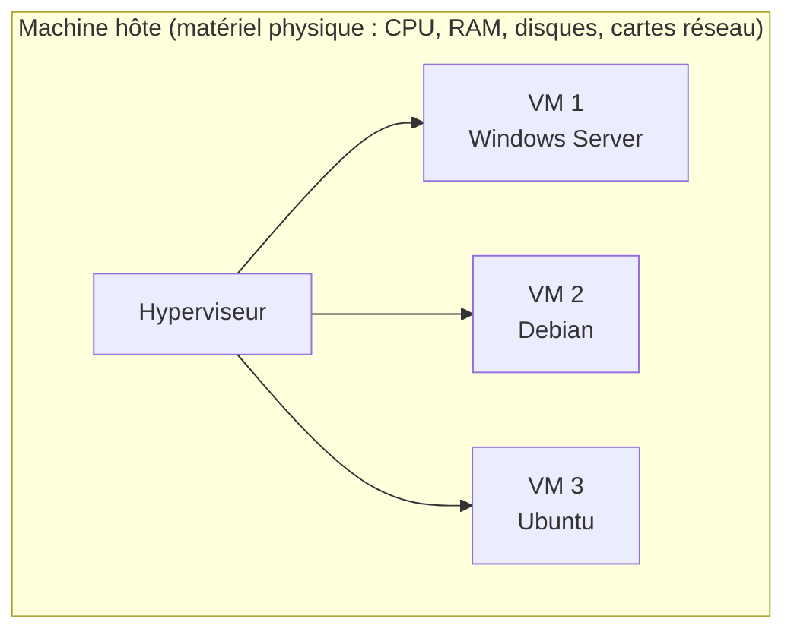
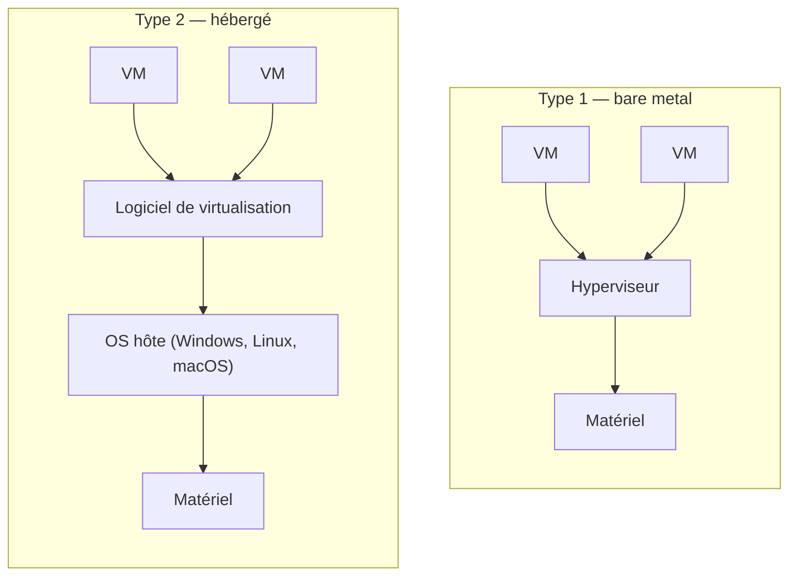
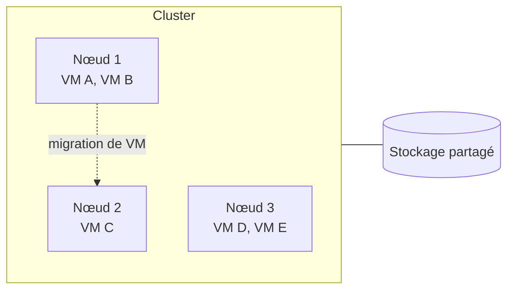

[Sommaire](Readme.md) · [Chapitre suivant →](02-Virtualisation-de-serveurs.md)

# La virtualisation : généralités

## 🎯 Objectifs du chapitre

- Définir la virtualisation
- Connaître ses avantages, ses inconvénients et les critères d'un bon projet
- Distinguer les hyperviseurs de type 1 et de type 2
- Comprendre l'intérêt d'un cluster d'hyperviseurs

---

## 1. Qu'est-ce que la virtualisation ?

La virtualisation consiste à exécuter, sur une **machine hôte** (ou
**hyperviseur**), un ou plusieurs systèmes d'exploitation installés dans des
**machines virtuelles** (VM).

Chaque VM croit disposer de son propre matériel ; c'est l'hyperviseur qui
partage entre elles les ressources réelles de l'hôte.

---

## 2. Avantages et inconvénients

### Avantages

- Mutualisation et allocation dynamique des ressources matérielles et logicielles
- Fin de la sous-utilisation des serveurs physiques
- Mutualisation de la consommation énergétique, de la climatisation et de la sécurisation physique des équipements
- Flexibilité dans la gestion de l'infrastructure
- Sauvegardes et restaurations facilitées
- Économies sur le long terme

### Inconvénients

- Coûts initiaux : infrastructure matérielle et licences
- Possible *overhead* : charge et temps perdus par les processus de gestion des machines virtuelles
- Risque de dégradation des performances d'une VM par ses voisines sur le même hôte, en particulier en cas de mauvais dimensionnement

### Critères de choix d'une solution de virtualisation

- Identifier correctement le besoin
- Choisir correctement sa solution de supervision et ses licences
- Bien dimensionner son infrastructure et anticiper les évolutions
- Conserver son indépendance vis-à-vis de la technologie choisie

---

## 3. Les types de virtualisation

Presque chaque composant d'un système d'information peut être virtualisé, plus
ou moins complètement. Les principaux types sont :

| Type | Ce qui est virtualisé | Chapitre |
|---|---|---|
| Postes de travail | l'environnement de l'utilisateur | [04](04-VDI-et-cloud-computing.md) |
| Serveurs | les serveurs d'infrastructure et d'application | [02](02-Virtualisation-de-serveurs.md) |
| Hardware | le matériel lui-même (CPU, mémoire…) | — |
| Logiciels et applications | une application, isolée de son OS | — |
| Stockage | les baies et volumes de stockage | [03](03-Stockage-et-reseau.md) |
| Réseau | commutateurs, routeurs, réseaux | [03](03-Stockage-et-reseau.md) |

---

## 4. Les types d'hyperviseurs

### Hyperviseur de type 1

Installé **directement sur le matériel** (*bare metal*), il fait lui-même
office de système d'exploitation. Adapté aux services d'infrastructure
d'entreprise.

Exemples : **Hyper-V**, **VMware ESXi**, **XenServer**, **KVM**, **Proxmox VE**.

### Hyperviseur de type 2

C'est un **logiciel exécuté sur un système d'exploitation hôte** (Windows,
Linux, macOS). Facile à mettre en œuvre, peu coûteux, il rend les VM
portables ; ses performances et ses fonctionnalités restent toutefois limitées
par rapport à un type 1.

Exemples : **VirtualBox**, **VMware Workstation**, **Virtual PC**, **Parallels**.

> 💡 Hyper-V, activable sur Windows 10/11, est souvent rangé parmi les types 2
> parce qu'il s'installe depuis un poste de travail. Techniquement, il s'insère
> sous Windows et reste un hyperviseur de type 1.

---

## 5. Cluster d'hyperviseurs

### Définition

Un **cluster** (ou grappe) désigne le regroupement de plusieurs machines :
serveurs, équipements réseau, baies de stockage…

### Avantages d'un cluster

- **Failover** (tolérance de pannes) : basculement lorsque le nœud principal est indisponible ou dysfonctionne
- **Load-balancing** : répartition de la charge entre les nœuds
- **Migration à froid ou à chaud** des VM vers un autre nœud d'exécution
- **Migration à froid ou à chaud** des VM vers un autre *datastore* (stockage)
- **HA — High Availability** : haute disponibilité des services

---

## ✅ Vérifier ses acquis

1. Quelle différence fondamentale sépare un hyperviseur de type 1 d'un hyperviseur de type 2 ?
2. Citez deux inconvénients de la virtualisation.
3. Qu'apporte un cluster d'hyperviseurs par rapport à un hyperviseur isolé ?

Voir la correction

1. Le type 1 s'installe directement sur le matériel et fait office d'OS ; le type 2 est un logiciel qui s'exécute sur un système d'exploitation hôte.
2. Au choix : coûts initiaux (matériel, licences), *overhead* de gestion, dégradation des performances d'une VM par ses voisines.
3. La tolérance de pannes (failover), la répartition de charge, la migration des VM entre nœuds ou entre datastores et la haute disponibilité.

---

[Sommaire](Readme.md) · [Chapitre suivant →](02-Virtualisation-de-serveurs.md)
