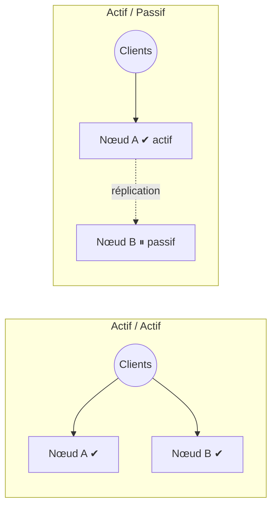

[← Chapitre précédent](01-Generalites.md) · [Sommaire](Readme.md) · [Chapitre suivant →](03-Stockage-et-reseau.md)

# Virtualisation de serveurs

La virtualisation de serveurs consiste à mutualiser les capacités de plusieurs
serveurs virtuels sur un serveur physique, nommé **hyperviseur**.

## 🎯 Objectifs du chapitre

- Maîtriser la terminologie de la virtualisation de serveurs
- Comprendre les concepts d'optimisation : concentration, consolidation, rationalisation, hyperconvergence
- Distinguer les mécanismes de disponibilité : failover, HA, FT, migration à chaud

---

## 1. Terminologie

| Terme | Définition |
|---|---|
| **Hôte** | Serveur physique qui met ses ressources matérielles à disposition dans un contexte de virtualisation |
| **Hyperviseur** | Solution logicielle installée sur l'hôte, qui fait fonctionner et administre les machines virtuelles |
| **VM** — *Virtual Machine* | Machine virtuelle (détail ci-dessous) |
| **VMM** — *Virtual Machine Manager* | Composant de gestion intégré à l'hyperviseur (détail ci-dessous) |
| **Cluster** | Regroupement (grappe, ferme) d'équipements en réseau, pour garantir leur qualité de service et leur disponibilité |
| **Nœud de cluster** | Élément constitutif d'un cluster |
| **Datastore** | Banque de données : conteneur logique composé de plusieurs périphériques de stockage. Une infrastructure peut en compter plusieurs |
| **vCPU** — *virtual CPU* | Processeur virtuel : unité de CPU physique attribuée à une VM. Un vCPU par VM par défaut, modifiable |
| **vRAM** — *virtual RAM* | Mémoire vive de l'hyperviseur attribuée à une VM |

### Ce qui compose une VM

- un fichier de caractéristiques matérielles ;
- un ou plusieurs fichiers d'image disque virtuels ;
- des ressources RAM, CPU et graphiques allouées par l'hôte, via l'hyperviseur ;
- une ou plusieurs cartes réseau virtuelles.

### Ce que permet le VMM

- créer, gérer, modifier et supprimer des VM ;
- gérer le matériel et les pilotes ;
- gérer le réseau ;
- gérer les espaces de stockage ;
- configurer les fonctionnalités de l'hyperviseur.

---

## 2. Optimiser l'infrastructure

| Concept | Ce qu'il optimise |
|---|---|
| **Concentration** | l'espace : un maximum de serveurs dans un espace le plus restreint possible |
| **Consolidation** | le taux d'utilisation de chaque serveur |
| **Rationalisation** | le parc : suppression des équipements redondants ou superflus |
| **Hyperconvergence** | les trois à la fois : architecture qui agrège traitement, stockage, réseau et virtualisation de plusieurs serveurs physiques |

### Provisionnement dynamique et surallocation

- **Provisionnement / allocation dynamique** : on attribue à une VM une
  quantité *maximale* de ressources (RAM, CPU, stockage), qu'elle n'exploite
  qu'en cas de besoin.
- **Surallocation** (*overcommitment*) : on alloue au total plus de RAM ou de
  CPU qu'il n'en existe réellement sur l'hyperviseur, en pariant que toutes
  les VM ne consommeront pas leur maximum en même temps.

> ⚠️ La surallocation est un levier d'économie, mais aussi la première cause
> de dégradation des performances lorsque le pari est perdu : elle se pilote
> avec une supervision sérieuse.

---

## 3. Contextes de gestion des hyperviseurs

Trois contextes de gestion coexistent :

1. **Gestion autonome** : chaque hyperviseur est administré seul ;
2. **Gestion globale** :
   - serveurs Hyper-V intégrés à un domaine Active Directory ;
   - serveurs ESXi intégrés à un contexte vSphere, grâce au composant **vCenter** ;
3. **Gestion de clusters** d'hyperviseurs.

---

## 4. Disponibilité et répartition de charge

### Load-balancing

Répartition des tâches et processus sur un ensemble de ressources, pour rendre
le traitement global plus efficace.

### Failover

Capacité d'un cluster à faire basculer le traitement d'un nœud vers un autre,
manuellement ou automatiquement. Deux modes :

- **Actif / Actif** : s'apparente à de l'équilibrage de charge, avec
  basculement du traitement si l'un des nœuds tombe en panne ;
- **Actif / Passif** : l'équipement passif est en veille, et réplique en
  permanence la configuration et les données de l'hôte actif.

### HA et FT

| | **HA** — *High Availability* | **FT** — *Fault Tolerance* |
|---|---|---|
| Principe | les VM ciblées redémarrent sur un autre hôte du cluster si leur hôte tombe | des VM identiques s'exécutent en parallèle sur plusieurs nœuds |
| Interruption de service | courte : le temps du redémarrage | aucune |
| Coût en ressources | faible | élevé : chaque VM protégée consomme deux fois |

### Mécanismes VMware

| Terme | Rôle |
|---|---|
| **vMotion** | migration à chaud d'une VM en cours d'exécution d'un hôte vers un autre, dans le même cluster |
| **Storage vMotion** | migration à chaud des fichiers de disque d'une VM d'un datastore vers un autre |
| **DRS** — *Distributed Resource Scheduler* | répartition automatique des VM entre les nœuds du cluster, par vMotion |
| **Storage DRS** | répartition automatique des fichiers de VM entre les datastores, par Storage vMotion |

---

## ✅ Vérifier ses acquis

1. Quelle est la différence entre consolidation et concentration ?
2. Une VM critique ne doit subir **aucune** interruption en cas de panne d'hôte. HA ou FT ?
3. Que fait DRS, et sur quel mécanisme repose-t-il ?

Voir la correction

1. La concentration optimise l'espace physique (plus de serveurs dans moins de place) ; la consolidation optimise le taux d'utilisation de chaque serveur.
2. FT : la VM tourne en double sur deux nœuds, l'autre copie prend le relais sans interruption. HA redémarre la VM, ce qui implique une coupure.
3. DRS répartit la charge en déplaçant les VM entre les nœuds du cluster ; il s'appuie sur vMotion.

---

[← Chapitre précédent](01-Generalites.md) · [Sommaire](Readme.md) · [Chapitre suivant →](03-Stockage-et-reseau.md)
