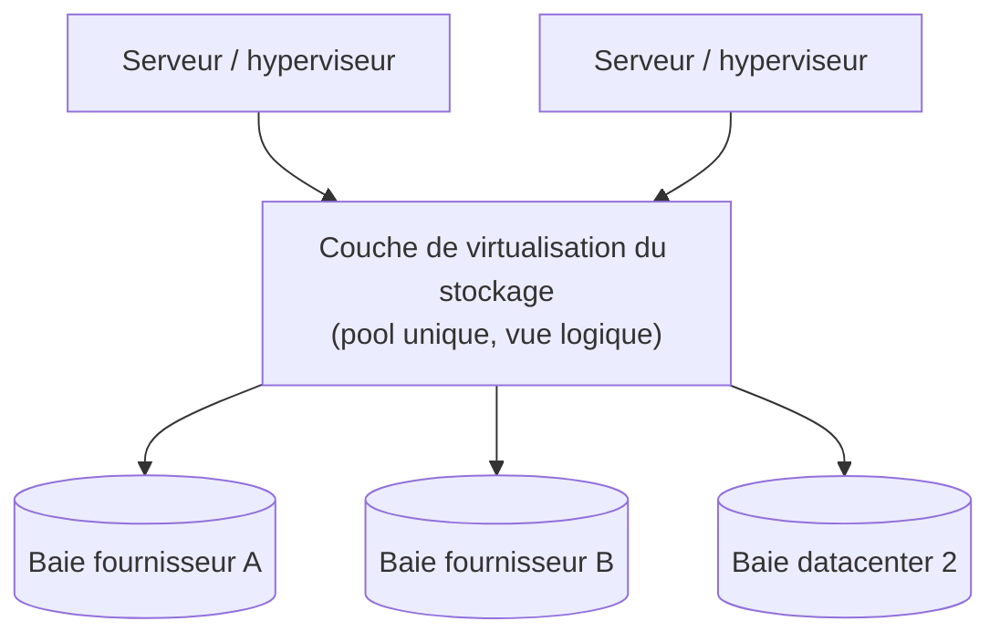
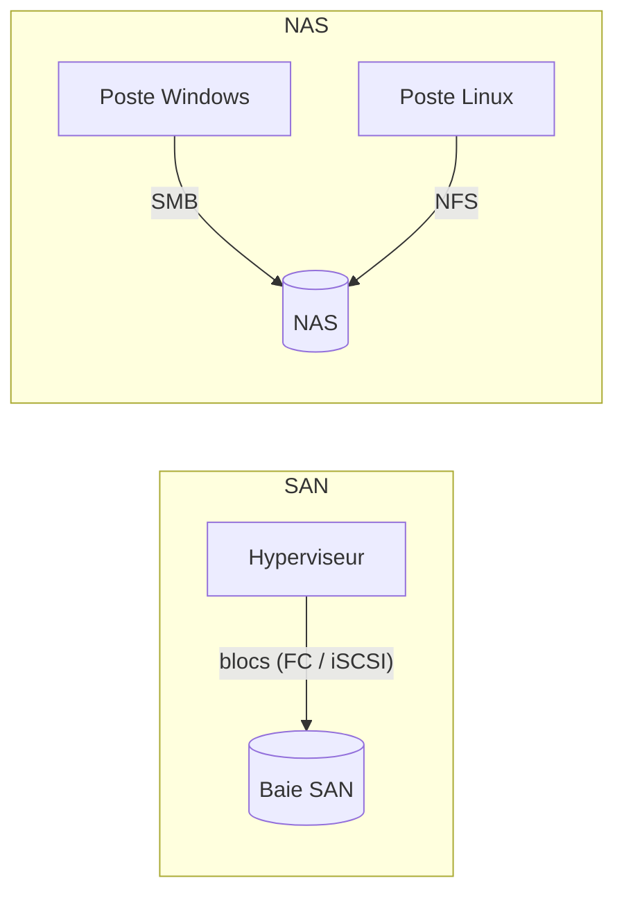
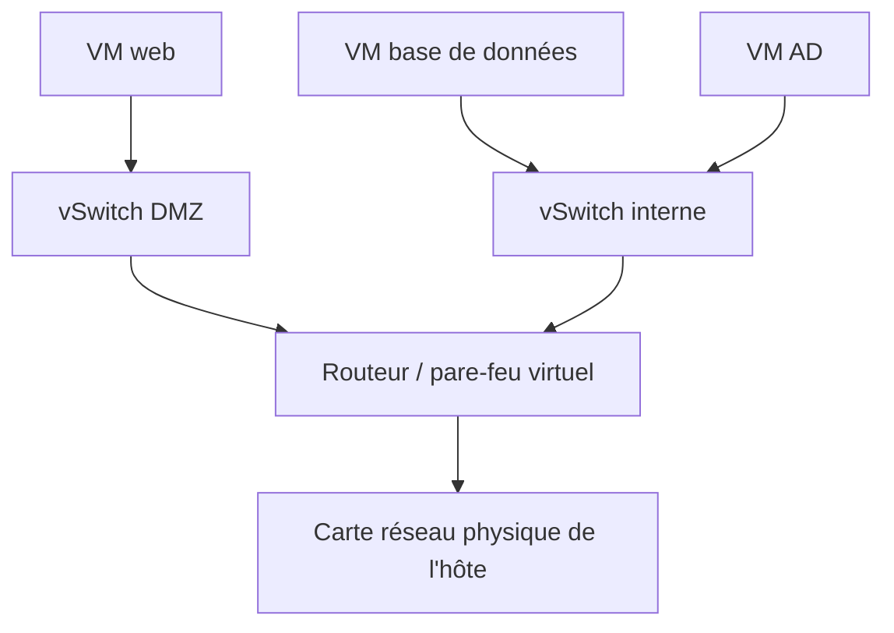

[← Chapitre précédent](02-Virtualisation-de-serveurs.md) · [Sommaire](Readme.md) · [Chapitre suivant →](04-VDI-et-cloud-computing.md)

# Virtualisation du stockage et du réseau

## 🎯 Objectifs du chapitre

- Connaître les objectifs de la virtualisation du stockage
- Situer les technologies Fibre Channel, iSCSI et SAS
- Distinguer un SAN d'un NAS
- Comprendre ce qu'apporte la virtualisation du réseau

---

## 1. Virtualisation du stockage

### Objectifs

La virtualisation du stockage (*Software-Defined Storage*, SDS) consiste à
regrouper en un *pool* plusieurs baies de stockage physiques des réseaux SAN.
Elle vise à :

- fédérer les volumes en une ressource virtuelle unique ;
- dissocier la gestion physique des disques et des baies des serveurs qui les utilisent ;
- faire cohabiter des matériels, des réseaux, des fournisseurs ou des datacenters différents ;
- fournir une vue logique sur une interface de gestion unique.

### Technologies associées

| Technologie | Description |
|---|---|
| **Fibre Channel** | Protocole de transport très haut débit (plusieurs Gbit/s), dédié à la connexion entre les serveurs et leur système de stockage ; il utilise son propre réseau, distinct du réseau IP |
| **iSCSI** — *Internet Small Computer System Interface* | Protocole de stockage réseau basé sur IP : il transporte des commandes SCSI sur un réseau Ethernet classique |
| **SAS** — *Serial Attached SCSI* | Interface de disques hautes performances, qui combine le jeu de commandes SCSI et la transmission série de l'interface SATA |

---

## 2. SAN ou NAS ?

| | **SAN** — *Storage Area Network* | **NAS** — *Network Attached Storage* |
|---|---|---|
| Nature | réseau spécialisé de mutualisation du stockage | serveur de fichiers réseau autonome |
| Ce que voit le client | des **blocs** : un disque, comme un disque interne | des **fichiers** : un partage réseau |
| Protocoles typiques | Fibre Channel, iSCSI | SMB/CIFS, NFS |
| Usage type | virtualisation d'infrastructures (datastores) | partage de fichiers entre clients hétérogènes |

---

## 3. Virtualisation du réseau

### Objectifs

La virtualisation du réseau remplace des ressources réseau traditionnelles,
matérielles, par une **implémentation logicielle** du réseau. Elle peut :

- combiner plusieurs réseaux physiques en un seul réseau logiciel virtuel ;
- ou diviser un réseau physique en plusieurs réseaux virtuels distincts et indépendants.

Elle s'appuie sur les fonctionnalités de l'hyperviseur, qui fournit des
composants virtuels : cartes réseau, **commutateurs virtuels** (vSwitch),
**routeurs virtuels**.

### Avantages

- gestion centralisée de la configuration et de la sécurité du réseau ;
- gestion simplifiée des VLAN : un réseau privé virtuel se comporte comme un réseau physique indépendant ;
- protocoles de routage mis en œuvre sans ajout de matériel ;
- flexibilité : ajout, suppression ou modification simplifiés des composants.

---

## ✅ Vérifier ses acquis

1. Un hyperviseur doit stocker les disques de ses VM sur une baie partagée. SAN ou NAS ?
2. Quel protocole permet de faire du stockage en mode bloc sur un réseau Ethernet/IP existant ?
3. Citez deux composants réseau qu'un hyperviseur sait virtualiser.

Voir la correction

1. Un SAN : il présente des volumes en mode bloc, comme des disques internes, ce qu'attend un datastore.
2. iSCSI.
3. Au choix : carte réseau, commutateur (vSwitch), routeur, réseau (VLAN).

---

[← Chapitre précédent](02-Virtualisation-de-serveurs.md) · [Sommaire](Readme.md) · [Chapitre suivant →](04-VDI-et-cloud-computing.md)
