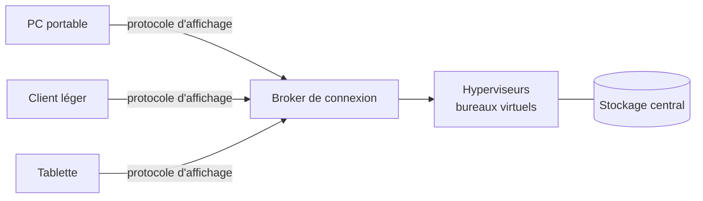
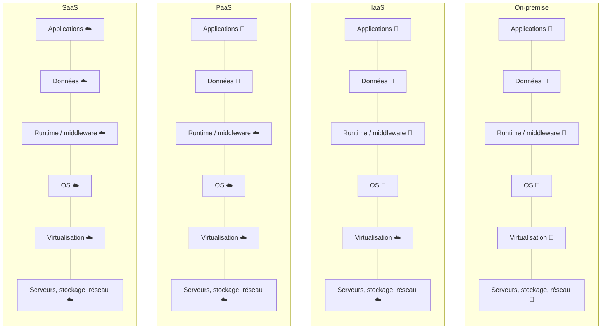

[← Chapitre précédent](03-Stockage-et-reseau.md) · [Sommaire](Readme.md) · [Chapitre suivant →](A-Glossaire.md)

# VDI et cloud computing

## 🎯 Objectifs du chapitre

- Comprendre la virtualisation des postes de travail (VDI), ses avantages et ses limites
- Définir le cloud computing, ses avantages et ses inconvénients
- Distinguer IaaS, PaaS et SaaS

---

## 1. VDI — Virtual Desktop Infrastructure

### Objectifs

La virtualisation de bureaux, ou **VDI**, dissocie l'environnement de
l'utilisateur de sa machine physique. Le poste de travail et les applications
dont l'utilisateur a besoin tournent sur l'infrastructure ; il s'y connecte
depuis **n'importe quel terminal**.

### Avantages

- centralisation des ressources et de la sécurité ;
- facilité de gestion et d'administration ;
- réduction des coûts à long terme : administration, énergie, matériel ;
- dissociation du matériel et du service ;
- optimisation des taux d'utilisation.

### Inconvénients

- criticité des hyperviseurs : s'ils tombent, plus personne ne travaille ;
- dépendance vis-à-vis d'une solution ;
- mise en œuvre et maîtrise de l'infrastructure exigeantes ;
- investissement initial important (matériel et licences).

---

## 2. Cloud computing

### Généralités

Le cloud computing (« informatique dans les nuages ») désigne la
**délocalisation** des infrastructures, des applications métiers et/ou des
données du SI chez un opérateur de service. Il repose sur des infrastructures
virtualisées colossales, installées dans des datacenters, et se décline en
offres proposées par des acteurs comme OVHcloud, Microsoft Azure, Oracle, IBM,
Google Cloud ou Amazon Web Services.

### Avantages

- mutualisation des coûts et réduction des charges de gestion ;
- qualité et haute disponibilité du service ;
- accessibilité depuis un navigateur, où que l'on soit ;
- évolutivité et flexibilité ;
- engagements contractuels de service (**SLA**).

### Inconvénients

- confidentialité et gouvernance des données ;
- dépendance au lien internet et au fournisseur ;
- réduction de la taille des équipes techniques internes.

---

## 3. IaaS, PaaS, SaaS

| Modèle | Ce que l'on loue | Ce que l'on gère soi-même | Exemples |
|---|---|---|---|
| **IaaS** — *Infrastructure as a Service* | des serveurs physiques ou virtuels | l'OS, le middleware, les applications, les données : contrôle total, compétences d'administration requises | machines virtuelles Azure, EC2, VPS |
| **PaaS** — *Platform as a Service* | une plateforme d'exécution hébergée | les applications et les données, sans se soucier de l'OS | hébergement de CMS, plateformes d'applications |
| **SaaS** — *Software as a Service* | un logiciel prêt à l'emploi, accessible par navigateur | uniquement ses données et son paramétrage | messagerie, suite bureautique en ligne |

### Schéma récapitulatif

Plus on monte, plus le fournisseur prend en charge de couches :

🧑 : géré par le client · ☁️ : géré par le fournisseur

---

## ✅ Vérifier ses acquis

1. Pourquoi la VDI rend-elle les hyperviseurs particulièrement critiques ?
2. Une équipe veut déployer son application web sans gérer de système d'exploitation. Quel modèle de cloud ?
3. Citez deux inconvénients du cloud computing.

Voir la correction

1. Tous les postes de travail tournent sur eux : une panne d'hyperviseur prive d'outil de travail tous les utilisateurs qu'il héberge.
2. PaaS.
3. Au choix : confidentialité et gouvernance des données, dépendance au lien internet et au fournisseur, réduction des équipes techniques internes.

---

[← Chapitre précédent](03-Stockage-et-reseau.md) · [Sommaire](Readme.md) · [Chapitre suivant →](A-Glossaire.md)
